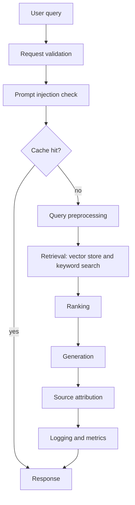
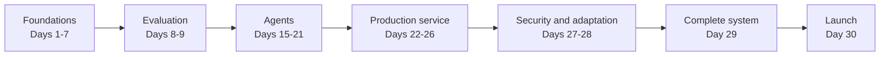

# RAG From Scratch

A complete Retrieval-Augmented Generation system, built one real piece at a time over 30 days, using only the Python standard library.

[](https://www.python.org/downloads/)
[](day-29-complete-system/requirements.txt)
[](#acknowledgements-and-license)

## Overview

This project builds a RAG system from first principles: keyword search, embeddings, a vector store, chunking, retrieval, ranking, generation, evaluation, agents, a production service, deployment, monitoring, security, and domain adaptation, each one implemented and tested before the next is built on top of it.

It is for anyone who wants to understand how every piece of a real RAG system actually works, not just how to call one through an API. Each day imports real code from earlier days instead of copying it, so the whole project stays consistent and the bugs found along the way stay fixed everywhere they apply.

It is not a production RAG framework, not a library meant to be installed and swapped into a real product, and not a security audit. It is honest, working teaching code, built so every claim in it can be read, run, and checked.

## Architecture

### Request pipeline



### Course layers



### Component map

| Component | File |
|---|---|
| Config and validation | `day-29-complete-system/config.py` |
| Knowledge base loading | `day-29-complete-system/knowledge_base.py` |
| Chunking | `day-04-chunking/chunking_strategies.py` |
| Embeddings | `day-29-complete-system/pipeline.py` (`text_to_embedding`) |
| Vector store | `day-03-vector-databases/simple_vector_db.py` |
| Query preprocessing | `day-05-retrieval/query_preprocessing.py` |
| Ranking | `day-06-ranking/practical_ranker.py` |
| Generation and sources | `day-07-generation/simple_generator.py`, `day-07-generation/source_attribution.py` |
| Caching | `day-14-caching/cache_eviction_strategies.py` (`LRUCache`) |
| Request validation | `day-22-production-rag/request_validation.py` |
| Prompt injection check | `day-27-security-privacy/prompt_injection_guard.py` |
| PII redaction | `day-27-security-privacy/pii_redaction.py` |
| Access control | `day-27-security-privacy/access_control.py` |
| Metrics | `day-24-monitoring/metrics_registry.py` |
| Full pipeline | `day-29-complete-system/pipeline.py` |
| Safe entry point | `day-29-complete-system/service.py` |
| Project command | `day-29-complete-system/main.py` |

## Quick start

Requirements: Python 3.10 or newer. Nothing else.

```bash
git clone https://github.com/eklavya114/rag-from-scratch.git
cd rag-from-scratch/day-29-complete-system
python main.py
python tests.py
```

`main.py` builds the complete system, answers three sample questions with their sources, and prints health and metrics. `tests.py` runs the test suite that must never break.

## Learning path

**Week 1, foundations (Days 1 to 7)**
- Day 1: the first RAG system, built with keyword search
- Day 2: embeddings, and how they differ from keyword matching
- Day 3: storing and searching embeddings in a vector database
- Day 4: splitting documents into chunks
- Day 5: a complete retriever tying chunking, embeddings, and the vector store together
- Day 6: ranking retrieved chunks by similarity, recency, and quality
- Day 7: generating sourced, readable answers

**Week 2, evaluation and hardening (Days 8 to 14)**
- Day 8: measuring retrieval quality with precision, recall, NDCG, and MRR
- Day 9: choosing and fine-tuning embedding models
- Day 10: scaling the pipeline from 100 to 100,000 documents
- Day 11: managing context windows and budgets
- Day 12: rewriting and expanding queries
- Day 13: reducing hallucinations and measuring factuality
- Day 14: multi-level caching

**Week 3, agents (Days 15 to 21)**
- Day 15: the first agent that can think, decide, and act
- Day 16: designing custom tools for an agent
- Day 17: the ReAct pattern for explicit reasoning
- Day 18: short-term, long-term, and episodic agent memory
- Day 19: structured function calling
- Day 20: multi-step planning and replanning
- Day 21: evaluating agent performance

**Week 4, production and real-world systems (Days 22 to 29)**
- Day 22: a production-style RAG service
- Day 23: deploying the service as an HTTP API
- Day 24: metrics, alerts, and monitoring
- Day 25: handling weird inputs and partial failures
- Day 26: A/B testing and significance checks
- Day 27: prompt injection checks, PII redaction, and access control
- Day 28: adapting the toy system to a real domain
- Day 29: connecting every piece into one complete, tested project

**Day 30, launch**
- A release checklist, a changelog, and this README

## Project structure

```
rag-from-scratch/
├── day-01-rag-basics/
├── day-02-embeddings/
├── day-03-vector-databases/
├── day-04-chunking/
├── day-05-retrieval/
├── day-06-ranking/
├── day-07-generation/
├── day-08-retrieval-quality/
├── day-09-embedding-models/
├── day-10-scaling/
├── day-11-context-windows/
├── day-12-query-rewriting/
├── day-13-hallucinations/
├── day-14-caching/
├── day-15-agentic-ai/
├── day-16-custom-tools/
├── day-17-react-pattern/
├── day-18-agent-memory/
├── day-19-function-calling/
├── day-20-planning/
├── day-21-agent-evaluation/
├── day-22-production-rag/
├── day-23-deployment/
├── day-24-monitoring/
├── day-25-edge-cases/
├── day-26-ab-testing/
├── day-27-security-privacy/
├── day-28-domain-adaptation/
├── day-29-complete-system/
└── day-30-launch/
```

## Design decisions

**Imports instead of copying code.** Every later day imports real functions and classes from earlier days rather than pasting a modified copy. A bug fixed once stays fixed everywhere it is used, and a real module-name collision between two days' `config.py` files was caught and fixed exactly because imports were real, not copied.

**Each day is self-contained.** Every folder has a README, a BEST_PRACTICES.md, runnable scripts, and a notebook, so a single day can be read and understood on its own, while still connecting to the rest of the project through real imports.

**Standard library only.** No vendor SDKs, no third-party packages. Every piece of this project is readable without installing anything, and runs without an API key, a GPU, or an internet connection.

**Honest toy components.** The embeddings, the vector store, and the generator are all deliberately small and simple, built to demonstrate the real mechanics (cosine similarity, ranking, retrieval-then-generation) without hiding behind a library that does the real work invisibly.

## Limitations

- Toy embeddings: a small, hand-built concept vocabulary, not a trained model
- In-memory vector store: a Python list scored with cosine similarity, not a real indexed database
- No real language model: answers come from templates filling in real retrieved text, never from an LLM
- Not a security audit: Day 27's security work is real and useful, but it is not a substitute for a professional review
- Not production-ready for real users: this project is teaching code, not a deployable product

## Roadmap

Based on `day-30-launch/next_steps.md`:

- Swap the toy embeddings for a real embedding model
- Replace the in-memory vector store with a real vector database
- Connect a real language model and re-run the Day 21 evaluation against it
- Add real monitoring and a real secrets manager
- Get a professional security review before any public launch

## Contributing

To add or improve a day, follow the existing pattern: a README explaining the topic, a BEST_PRACTICES.md with short notes, runnable scripts that import from earlier days rather than copying them, and a notebook that ties the scripts together end to end. Keep everything in the standard library, and keep every script fast enough to run in a few seconds.

## Acknowledgements and license

This repository does not yet include a LICENSE file. A license is pending.
